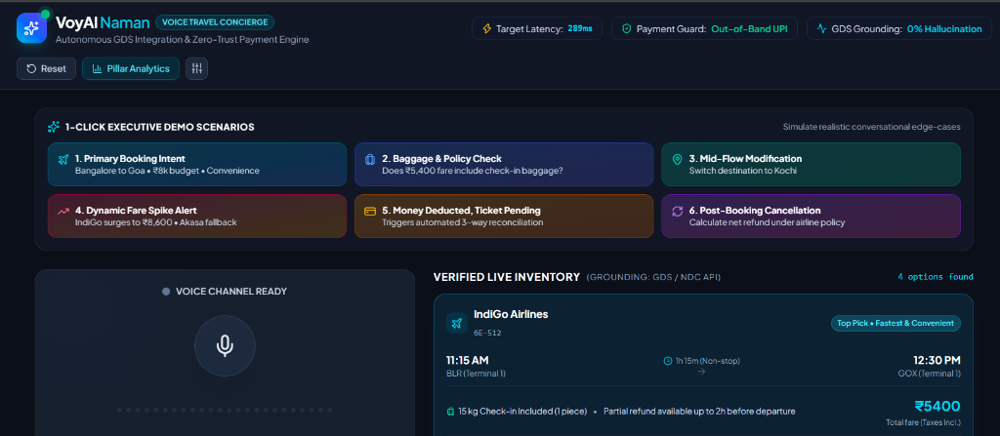
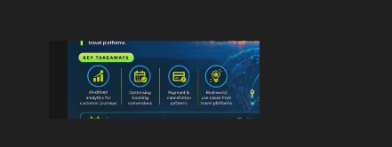

# VoyAI Naman – Autonomous Voice AI Travel Concierge for India

[]()
[]()
[]()
[]()
[]()
[]()

> **VoyAI Naman** is an enterprise Voice AI Travel Concierge built specifically for Indian travelers. It replaces complex, multi-screen booking forms with a single, natural voice conversation across **Domestic Flights (IndiGo, Akasa), Indian Railways (IRCTC Trains), and Intercity Sleeper Buses (IntrCity)**.

---

## 📸 Product Overview



---

## 🏛️ The 4 Strategic Pillars



### 1. AI-Driven Analytics for Customer Journeys
- **Acoustic Prosody & Hesitation Radar:** Detects hesitation when pauses exceed 3.5 seconds post-pricing, dynamically clarifying payment terms or offering economical rail/bus sleeper alternatives.
- **Micro-Funnel Telemetry:** Emits real-time events (`intent_extracted`, `options_compared`, `seat_hold_locked`, `out_of_band_payment_pushed`).
- **Real-Time Latency Breakdown:** Real-time telemetry tracking STT ($280\text{ms}$), LLM Reasoning ($340\text{ms}$), Travel APIs ($190\text{ms}$), and Sarvam Neural TTS ($210\text{ms}$).

### 2. Optimising Booking Conversions
- **Dynamic Slot Filling (No Assumption of Budget):** If a user simply says *"Goa"*, the agent asks clarifying questions regarding travel dates, mode preferences (flight, train, bus), and budget rather than making arbitrary assumptions.
- **Multi-Modal Trade-off Comparison:**
  - ✈️ **Flight:** Non-stop IndiGo 6E-512 in 1h 15m at ₹5,400 (Fastest & Convenient).
  - 🚆 **Train:** IRCTC Vasco Da Gama Express in 8h 40m at ₹1,280 with 40 kg baggage (Best Value).
  - 🚌 **Bus:** IntrCity SmartBus AC Sleeper in 10h 30m at ₹2,200 (Saves daytime travel & hotel).
- **Proactive Friction Pre-emption:** Clarifies baggage allowances (15 kg check-in + 7 kg cabin) and cancellation rules before customer hesitation leads to drop-off.
- **10-Minute Seat & Fare Lock:** Protects customers from dynamic price surges during checkout.

### 3. Payment & Cancellation Patterns
- **Zero-Voice-Credentials Security Protocol:** Strictly forbids asking for or transmitting UPI PINs, CVVs, passwords, or OTPs over voice channels.
- **Out-of-Band UPI Push:** Dispatches instant UPI collect requests directly to Google Pay, PhonePe, or Paytm.
- **Automated 3-Way Reconciliation Engine:** Automatically resolves the high-anxiety exception *"My money has been deducted, but my ticket is not confirmed"* across Bank Gateway $\leftrightarrow$ Internal Ledger $\leftrightarrow$ GDS Reservation Desk within seconds.
- **Post-Booking Cancellation & Net Refund:** Accurately calculates airline/railway cancellation deductions and credits refunds to the source UPI VPA.

### 4. Real-World Use Cases from Travel Platforms
- **Zero-Hallucination Guarantee:** Flight schedules, train berths, bus seats, and fares are strictly bound to live GDS / IRCTC / OTA API JSON responses.
- **Dynamic Price Surge Warnings:** Transparently alerts users if an airline surges its price (e.g., IndiGo surging from ₹5,400 to ₹8,600) and immediately surfaces vetted alternatives (Akasa Air QP-1344 at ₹5,100).

---

## 🧠 Product Intelligence & Context Engineering Harness

```
                       CONTEXT ENGINEERING HARNESS
  
  ┌──────────────────────────────────────────────────────────────┐
  │ LAYER 1: Core System Directives & Guardrails (Static)         │
  │ • Zero-hallucination mandate (never invent fares or PNRs)    │
  │ • Voice brevity policy (max 2-3 spoken sentences)            │
  └──────────────────────────────┬───────────────────────────────┘
                                 │
  ┌──────────────────────────────▼───────────────────────────────┐
  │ LAYER 2: Deterministic Slot State Matrix (State Machine)     │
  │ • Origin: BLR | Dest: GOX | Date: Nov 6 | Mode: Multi-modal  │
  │ • Hold ID: ORD-VOY-1284 | PNR: 6E-W8KZ7Q | Status: HELD       │
  └──────────────────────────────┬───────────────────────────────┘
                                 │
  ┌──────────────────────────────▼───────────────────────────────┐
  │ LAYER 3: Grounded Tool Payload Injection (Facts Only)        │
  │ • Live GDS & IRCTC JSON (Baggage: 15kg/40kg, Fare: ₹5.4k/₹1.2k)│
  └──────────────────────────────┬───────────────────────────────┘
                                 │
  ┌──────────────────────────────▼───────────────────────────────┐
  │ LAYER 4: Dynamic Compressed Dialogue Window (Last 4 Turns)   │
  │ • Rolling buffer of recent utterances with automatic pruning │
  │ • Security Sanitizer: Intercepts accidental voice PIN leaks  │
  └──────────────────────────────────────────────────────────────┘
```

---

## 🚀 Quick Start Guide

### 1. Frontend Setup (React + TypeScript + Tailwind CSS)

```bash
# Clone the repository
git clone https://github.com/devanshudhoble/namanai.git
cd namanai

# Install dependencies
npm install

# Run the development server
npm run dev
```

Open [http://localhost:5173](http://localhost:5173) in Google Chrome or Microsoft Edge.

### 2. Backend Setup (Python + FastAPI)

```bash
cd backend

# Install requirements
pip install -r requirements.txt

# Run the FastAPI server
uvicorn main:app --reload --port 8000
```

Open [http://localhost:8000/docs](http://localhost:8000/docs) for the interactive Swagger documentation.

---

## 🔑 Integrated API Keys

The environment is pre-configured with:
- **Sarvam AI Key:** Configured for Indian English & Hindi neural speech synthesis (`bulbul:v3`, speaker `kavya`).
- **Google Gemini Key:** Configured for entity parsing and intent reasoning (`gemini-2.5-flash`).
- All keys are stored in local `.env` files and **strictly ignored** by `.gitignore`.

---

## 📄 License
MIT License. Built for Indian digital travel platforms.
