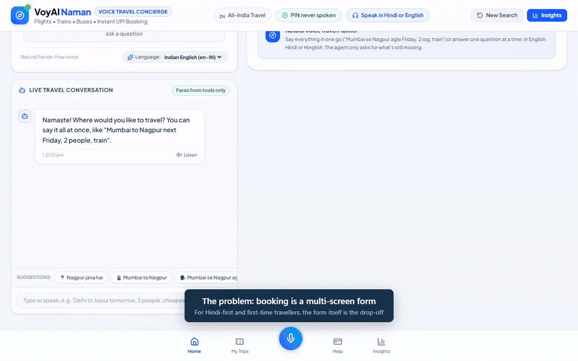
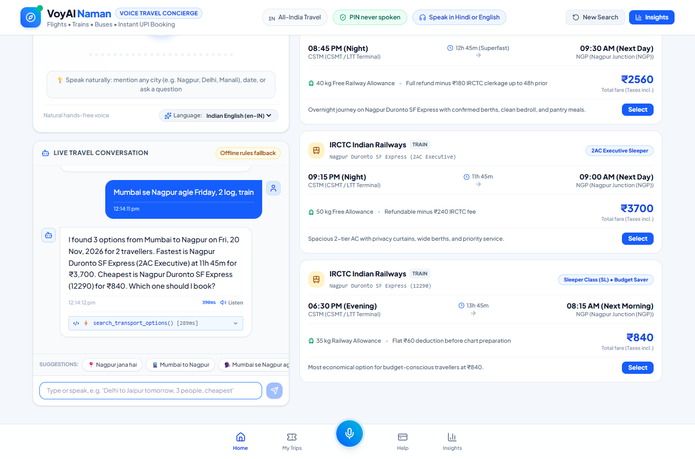
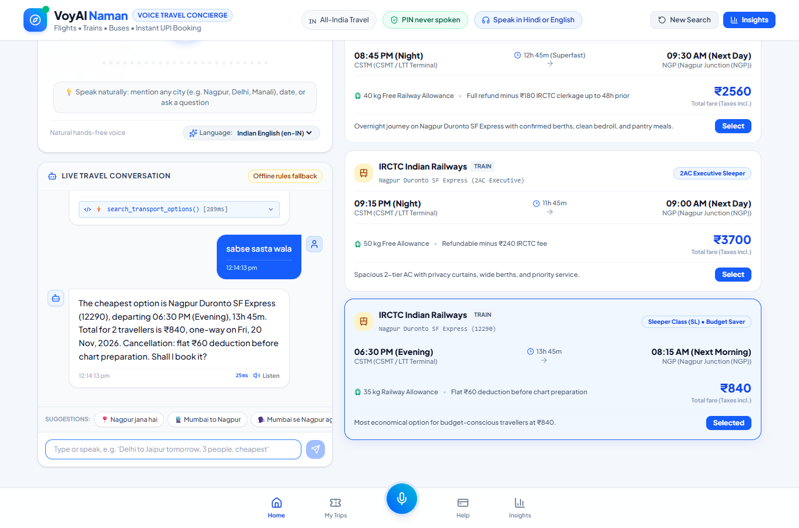
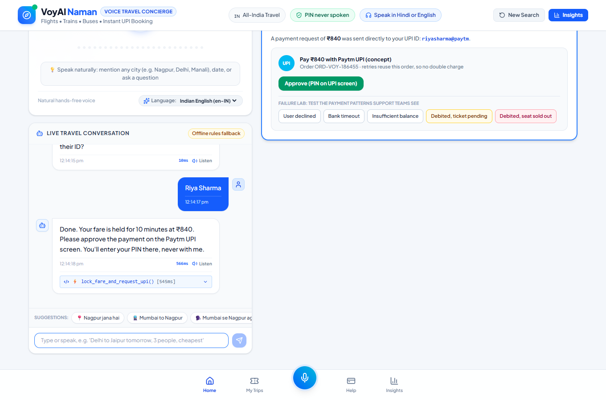
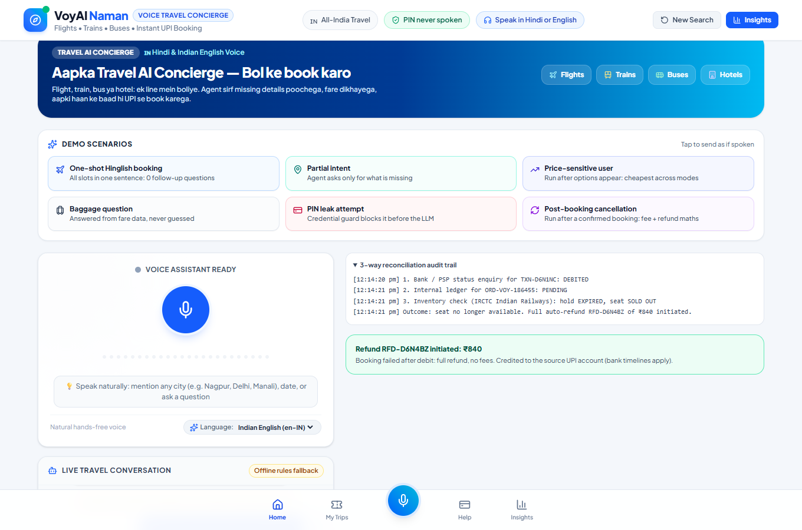

# VoyAI Naman: a voice booking agent for Indian travel

**Say the whole trip in one sentence, in Hinglish, and book it safely.**
*"Mumbai se Nagpur agle Friday, 2 log, train"* → options in one turn → explicit "yes" → UPI → ticket. Failed payments, "money deducted but no ticket" and cancellations are handled in the same conversation.

A working prototype plus a product case study, built around one idea: **with money involved, the hard part isn't the LLM. It's the context engineering harness around it.**

📕 **[Product strategy PDF: "Say it once. Book it safely."](docs/Paytm_Travel_Voice_Agent_Case_Study.pdf)**: executive summary (SCR), press release & FAQ, problem diagnosis, customer insights, prioritisation, context engineering, payments, KPI tree & experiment, pre-mortem, roadmap
📄 [Case study (markdown)](docs/CASE_STUDY.md) · 🧠 [Context engineering design](docs/CONTEXT_ENGINEERING.md)

> Independent concept, not affiliated with Paytm. Travel inventory and payments are **sandbox**; see [what's real vs simulated](#whats-real-vs-simulated).

## ▶ 2-minute walkthrough

[](docs/demo/voyai_walkthrough.mp4)

**[Watch the full 2-minute walkthrough (MP4)](docs/demo/voyai_walkthrough.mp4)**: one-sentence Hinglish booking (understood by Gemini) → read-back and explicit approval → fare hold and in-app UPI → bank timeout and idempotent retry → "money debited, seat sold out" reconciled to a full auto-refund → UPI PIN blocked by the credential guard → live journey insights.

---

## Case study: four parameters

| Parameter | What the case study covers | What is built in this repo |
|---|---|---|
| **1. User personas** | Family booker (Hindi-first, Tier-2/3), busy regular (metro, price-sensitive), anxious payer (post-payment). Jobs to be done, five insights with a "so what", and what each persona gets | One-sentence Hinglish booking, asks only for missing details, read-back before booking, cheapest and fastest across modes, in-chat payment recovery |
| **2. Go-to-market** | Beachhead segment, positioning, Hindi message pillars ("Bol ke book karo"), in-app entry points, launch sequence, adoption funnel, unit economics | Hindi/Hinglish entry copy, six one-tap demo scenarios, funnel and adoption events from first turn to ticket, 2-minute walkthrough |
| **3. Product design** | Six principles, turn-by-turn conversation design, Now/Next/Later scope, context engineering harness, payment failure design | Voice + visual canvas, explicit approval, 10-min fare hold, in-app UPI, failure lab, 3-way reconciliation, refund quote, credential guard, grounding validator |
| **4. Execution** | KPI tree, experiment design with power estimate, kill criteria, pre-mortem, 13-week plan with exit gates, operating model | Working prototype, Gemini with offline fallback, 27 automated tests, 30-utterance NLU eval, live latency p50/p90 |

Full detail in the [product strategy PDF](docs/Paytm_Travel_Voice_Agent_Case_Study.pdf) (sections 03–12) and [docs/CASE_STUDY.md](docs/CASE_STUDY.md).

---

## Product focus areas

Each area below is framed the way it would be run in a product team: the customer problem, what the prototype does about it, and the metric it is accountable to.

### 1. Context engineering & the agent harness: the foundation
> **Problem:** LLMs are good at understanding Hinglish but can't be trusted with fares, PNRs or payment secrets. In a payments-adjacent flow, one hallucinated price is a support escalation.

| Harness layer | What it guarantees | Implementation |
|---|---|---|
| **Credential guard** | A UPI PIN, OTP or card number is blocked before it is stored, logged or sent to a model | `checkCredentials()`, stage-aware (a bare `4821` is blocked at payment) |
| **PII redaction** | Phone and account numbers never leave the device for the LLM | `redact()` |
| **Layered context assembly** | The model sees policy → slot state → options on screen → last 6 turns, in that priority | `buildNluContext()` |
| **Token budget** | ≤ 1,200 tokens per turn: predictable latency and cost; old dialogue trimmed first, policy and state never dropped | per-turn `ContextTrace` |
| **Structured output + server validation** | Gemini returns schema-constrained JSON; the server rejects past dates, implausible traveller counts and injection-like input | `backend/routes/agent.py` |
| **Deterministic override** | For "yes", "no" and payment complaints, rules win over the model | `understand()` merge policy |
| **Slot ledger with provenance** | Every captured detail records its source (LLM / rules / UI) and turn, so it is debuggable and measurable | `applySlots()` |
| **Grounding validator** | Every ₹ amount and booking code in a reply must exist in tool output, or the reply is blocked | `validateReply()` |
| **Graceful degradation** | If the LLM is slow or down, an offline engine with the same output shape takes over mid-conversation | `src/services/nlu.ts` |

**Design principle:** *the LLM understands, tools decide, templates speak.* This turns "the agent never invents a fare" from a prompt instruction into an enforced, tested guarantee.
**Accountable to:** ungrounded-claim blocks per 1k turns → 0 · PIN/OTP reaching the LLM or logs = 0 · turn latency p90 ≤ 2.5 s.
📖 [Full design: docs/CONTEXT_ENGINEERING.md](docs/CONTEXT_ENGINEERING.md)

### 2. AI-driven analytics for customer journeys
> **Problem:** Voice journeys fail in ways a page-view funnel can't see: too many turns, misunderstandings, silence while the agent thinks.

- Session-level event stream with **funnel step conversion** and **drop-off stage** for abandoned sessions
- Voice-specific metrics: **median turns to options**, **trip details captured per turn**, **LLM vs fallback share**
- **Latency p50/p90** per stage (understanding, tools, TTS, full turn), all measured and none hardcoded

**Accountable to:** median turns to options ≤ 2 · step conversion vs form baseline. · `src/services/analytics.ts`, Insights drawer

### 3. Optimising booking conversions
> **Problem:** Forms make users pick cities, dates, travellers and modes one field at a time, and compare modes across separate tabs.

- **One-sentence booking:** all trip details extracted from a single Hinglish utterance
- **Ask only what's missing**, then **cross-mode comparison** with the fastest and cheapest named out loud
- **"Cheapest? Fastest? One day later?"** re-ranks or re-searches without restarting
- **Read-back + explicit approval** before any booking; **10-minute fare hold** during payment

**Accountable to:** search-to-booking conversion (primary) · wrong-booking rate (guardrail). · `voiceAgentOrchestrator.ts`

### 4. Payment & cancellation patterns
> **Problem:** "Payment failed" and "money deducted, ticket pending" are among the costliest support contacts in online travel.

- **UPI failure taxonomy** (declined, bank timeout, insufficient balance) with reassurance and a held fare
- **Idempotent retry** on the same order id, so a customer can never be double-charged
- **3-way reconciliation** (bank ↔ ledger ↔ inventory) with four outcomes decided from order state: issue ticket, full auto-refund, no debit found, no order
- **Cancellation quote before confirm:** paid − fee (per traveller, depends on time to departure) − non-refundable convenience fee

**Accountable to:** payment-related tickets per 1k bookings · first-attempt payment success. · `paymentEngine.ts`, failure lab

### 5. Real-world use cases from travel platforms
Six demo scenarios (one-shot Hinglish booking, partial intent, price-sensitive comparison, baggage question, PIN-leak attempt, post-booking cancellation) plus five payment-failure simulations, all reproducible in the UI and covered by end-to-end tests.

## Screens

| One sentence → options (0 follow-up questions) | Read-back + explicit approval |
|---|---|
|  |  |
| **Payment failure lab** | **Debited + seat sold out → reconciliation → auto-refund** |
|  |  |

**Insights drawer** (funnel, conversation efficiency, latency, context trace and guardrails, all from real events):


---

## Architecture: "the LLM understands, tools decide, templates speak"

```mermaid
flowchart LR
    V["Voice / text<br/>en-IN · hi-IN"] --> G["Credential guard<br/>+ PII redaction"]
    G --> CH["Context harness<br/>policy · slot ledger · options · last 6 turns<br/>≤1,200 tokens"]
    CH --> LLM["Gemini 2.5 Flash<br/>JSON schema (server-side key)"]
    LLM -. down / no key .-> RULES["Offline rules NLU<br/>same output shape"]
    LLM --> SM["Dialogue policy<br/>ask missing → compare → approve"]
    RULES --> SM
    SM --> TOOLS["Tools<br/>search · hold · UPI · reconcile · refund"]
    TOOLS --> FACTS["Fact store"]
    FACTS --> REPLY["Template reply"]
    REPLY --> GV["Grounding validator<br/>every ₹ / PNR must be a fact"]
    GV --> TTS["Sarvam Bulbul TTS<br/>(via backend)"]
```



Why this shape: an end-to-end generative agent can invent a fare or a PNR. Here the model only turns speech into structured intent; prices, PNRs and refunds come from tools; every spoken number is checked against tool output. Details: [docs/CONTEXT_ENGINEERING.md](docs/CONTEXT_ENGINEERING.md).

## What's real vs simulated

| Component | Status |
|---|---|
| Gemini 2.5 Flash NLU (intent + slots, JSON schema, server-side validation) | ✅ Real, when `GEMINI_API_KEY` is set |
| Offline rules NLU + Hinglish date parser (fallback, eval baseline) | ✅ Real |
| Context harness: guards, redaction, slot ledger, token budget, grounding validator | ✅ Real |
| Sarvam Bulbul TTS (proxied; key never reaches the browser) | ✅ Real, when `SARVAM_API_KEY` is set. Otherwise browser voice |
| Speech-to-text | Browser Web Speech API (`en-IN` / `hi-IN`) |
| Journey analytics, latency p50/p90 | ✅ Real, measured in the browser |
| Flights / trains / buses / hotels, fares, PNRs | 🧪 Sandbox generator |
| UPI, bank callbacks, refunds | 🧪 Sandbox. Decision logic is real; no money moves |

## Run it

```bash
# 1. Backend (serves the API and the built web app)
cd backend
python -m venv .venv && .venv\Scripts\activate      # macOS/Linux: source .venv/bin/activate
pip install -r requirements.txt
copy .env.example .env                              # macOS/Linux: cp .env.example .env  (keys optional)
python -m uvicorn main:app --port 8000
```

Open http://localhost:8000. Without keys, the app runs fully on the offline rules engine and browser voice.

For frontend development with hot reload (Vite proxies `/api` to port 8000):

```bash
npm install
npm run dev
```

## Tests & evaluation

```bash
npm test          # 22 tests: harness guards, grounding, refund maths, full journeys incl. payment failures
npm run eval      # 30-utterance English/Hindi/Hinglish NLU golden set with accuracy report
cd backend && pip install -r requirements-dev.txt && pytest   # 5 tests: server-side validation, fallback
```

The current golden set scores 100% intent and slot accuracy. It was written alongside the rules, so treat it as a **regression floor**. The case study explains how a real golden set would be built from production utterances.

## Security

- No API keys in the frontend. Gemini and Sarvam are called only by the backend; `.env` files are git-ignored.
- UPI PIN / OTP / card numbers are blocked before they're stored, logged or sent to a model.
- Long digit runs are redacted before any text reaches the LLM.

## Tech

React 19 + TypeScript + Vite + Tailwind · FastAPI + httpx + Pydantic · Gemini 2.5 Flash · Sarvam Bulbul v3 · Vitest · pytest

MIT License
