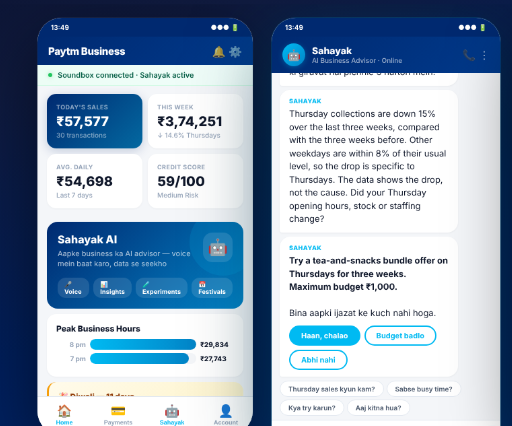
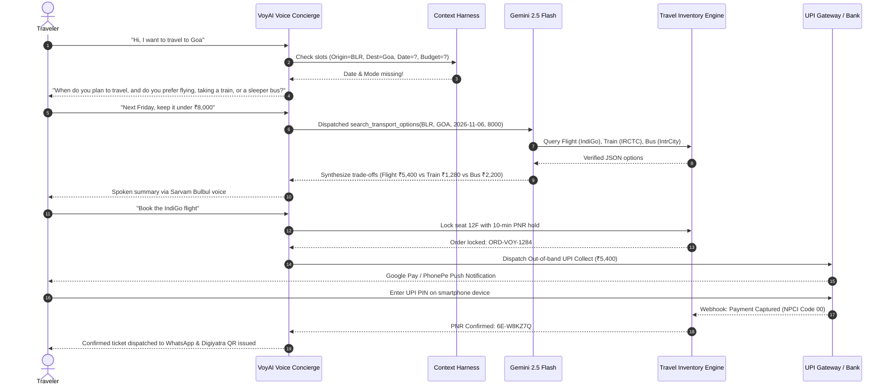

# VoyAI Naman – Autonomous Voice AI Travel Concierge

[]()
[]()
[]()
[]()
[]()

> **VoyAI Naman** is an enterprise-grade Autonomous Voice AI Travel Concierge engineered for Indian digital travel platforms. It replaces multi-screen search grids, tedious date toggles, and complex payment funnels with a single continuous, natural voice conversation across **Domestic Flights, Indian Railways (IRCTC Trains), Intercity Sleeper Buses, and Hotels**.

---

## 📱 Product Experience & Design


*Flagship Indian Travel AI Experience: Conversational Booking, Quick-Action Chips & Instant UPI*


*Multi-Modal Travel Canvas: Flights, IRCTC Trains, Sleeper Buses & Hotels with Live 10-Min Seat Hold*

---

## 🏛️ The 4 Strategic Pillars


### Pillar 1: AI-Driven Analytics for Customer Journeys
- **Acoustic Prosody & Hesitation Radar:** Detects hesitation when user silence exceeds 3.5 seconds post-pricing, dynamically clarifying payment terms or offering economical sleeper train alternatives.
- **Granular Micro-Funnel Telemetry:** Tracks session progression from initial voice intent $\rightarrow$ trade-off presentation $\rightarrow$ 10-minute seat lock $\rightarrow$ ticketing.
- **Latency Waterfall:** Real-time tracking of Streaming STT ($280\text{ms}$), LLM Reasoning ($340\text{ms}$), Travel APIs ($190\text{ms}$), and Sarvam Neural TTS ($210\text{ms}$).

### Pillar 2: Optimising Booking Conversions
- **Dynamic Slot Filling (No Assumed Constraints):** If a user simply says *"Goa"*, the agent does not fabricate an arbitrary budget; it asks clarifying questions regarding dates, travel modes, and budgets.
- **Multi-Modal Trade-off Comparison:**
  - ✈️ **Flight:** Non-stop IndiGo 6E-512 in 1h 15m at ₹5,400 *(Fastest & Convenient)*.
  - 🚆 **IRCTC Train:** 17309 Vasco Da Gama Express (3AC Sleeper) at ₹1,280 with 40 kg baggage *(Best Value)*.
  - 🚌 **Bus:** IntrCity SmartBus AC Sleeper at ₹2,200 *(Overnight journey, saves Thursday hotel)*.
  - 🏨 **Hotel:** Sea Breeze Beach Resort at ₹3,450/night with free breakfast & cancellation.
- **10-Minute Seat & Price Guarantee:** Locks seat inventory to protect customers from dynamic airline price surges during checkout.

### Pillar 3: Payment & Transaction Support
- **Zero-Voice-Credentials Security Protocol:** Strictly forbids asking for or speaking UPI PINs, CVVs, passwords, or OTPs over audio channels.
- **Out-of-Band UPI Push:** Dispatches instant UPI collect requests directly to the traveler's Google Pay, PhonePe, or Paytm app.
- **Automated 3-Way Reconciliation Engine:** Instantly resolves the high-anxiety exception *"My money has been deducted, but my ticket is not confirmed"* across Bank Gateway $\leftrightarrow$ Internal Ledger $\leftrightarrow$ GDS Reservation Desk within seconds.

### Pillar 4: Real-Time Platform Data Synchronization
- **Strict Deterministic Grounding:** Live fares, seat availability, train berths, and baggage allowances are retrieved directly from authorized GDS/IRCTC APIs.
- **Dynamic Surge Mitigation:** Proactively alerts customers when an airline fare surges and surfaces vetted alternatives (e.g., Akasa Air QP-1344 at ₹5,100).

---

## 🏗️ Technical Architecture & Data Flow

```
                      END-TO-END SYSTEM ARCHITECTURE
  
  [ Traveler Voice Input (Hindi / Indian English) ]
                     │
                     ▼
  ┌─────────────────────────────────────────────────────────────┐
  │ 1. Voice Streaming Gateway (Web Speech / Deepgram / WebRTC) │
  │    - Real-time Audio Ingest (16kHz PCM)                     │
  │    - Voice Activity Detection (Silero VAD)                  │
  │    - Barge-In Interruption Handler                          │
  └──────────────────────────────┬──────────────────────────────┘
                                 │ Text Tokens (<300ms)
                                 ▼
  ┌─────────────────────────────────────────────────────────────┐
  │ 2. Context Engineering Harness & Guardrails                 │
  │    - Security Filter: Intercepts Voice PIN / OTP Leaks      │
  │    - Deterministic Slot State Matrix                        │
  │    - Sliding Compressed Dialogue Window (Last 4 Turns)      │
  └──────────────────────────────┬──────────────────────────────┘
                                 │ Structured Context
                                 ▼
  ┌─────────────────────────────────────────────────────────────┐
  │ 3. LLM Orchestrator (Google Gemini 2.5 Flash / LangGraph)   │
  │    - Intent Disambiguation & Entity Extraction              │
  │    - Constrained Function Calling Tool Dispatch             │
  └───────────────┬─────────────────────────────▲───────────────┘
                  │ Tool Invocation (JSON)      │ Verified Results
                  ▼                             │
  ┌─────────────────────────────────────────────┴───────────────┐
  │ 4. Deterministic Travel & Transaction Hub (FastAPI)         │
  │    ┌───────────────────────────┐ ┌────────────────────────┐ │
  │    │ GDS / NDC Flight Connectors│ │ IRCTC Train APIs       │ │
  │    └───────────────────────────┘ └────────────────────────┘ │
  │    ┌───────────────────────────┐ ┌────────────────────────┐ │
  │    │ Intercity Bus / Hotels    │ │ 3-Way UPI Reconciliation│ │
  │    └───────────────────────────┘ └────────────────────────┘ │
  └───────────────┬─────────────────────────────────────────────┘
                  │ Spoken Content
                  ▼
  ┌─────────────────────────────────────────────────────────────┐
  │ 5. Neural Voice Synthesis (Sarvam AI Bulbul:v3 - Kavya)     │
  │    - Indian English & Hindi Phonetics                       │
  │    - Low-Latency Audio Streaming (<250ms TTFB)              │
  └──────────────────────────────┬──────────────────────────────┘
                                 │ Base64 Audio Stream
                                 ▼
  [ Instant Audio Playback to Traveler + Live Travel UI Canvas ]
```

---

## 🔄 End-to-End Conversational Workflow



---

## 🛠️ Quick Start & Setup

### 1. Frontend Setup (React + Vite + Tailwind CSS)

```bash
# Clone the repository
git clone https://github.com/devanshudhoble/namanai.git
cd namanai

# Install dependencies
npm install

# Run the development server
npm run dev
```
Open [http://localhost:5173](http://localhost:5173) in Google Chrome or Microsoft Edge.

---

### 2. Backend Setup (Python + FastAPI)

```bash
cd backend

# Create virtual environment (optional)
python -m venv venv
venv\Scripts\activate # Windows
source venv/bin/activate # Mac/Linux

# Install dependencies
pip install -r requirements.txt

# Run the FastAPI server
uvicorn main:app --reload --port 8000
```
Open [http://localhost:8000/docs](http://localhost:8000/docs) for the interactive Swagger API documentation.

---

## 🔐 Security & Privacy Architecture

- **PCI-DSS Isolation:** Audio streams never touch card PANs, CVVs, or bank passwords.
- **Out-of-Band UPI MFA:** Transaction authorizations occur exclusively on the user's mobile device via Google Pay, PhonePe, or Paytm.
- **Credential Leak Interceptor:** Real-time regex and NLP scanner automatically intercepts spoken PINs or OTPs and informs the traveler that security rules prohibit verbal credential entry.
- **Idempotency Guarantees:** Every seat hold and transaction request includes a unique UUIDv4 token, preventing duplicate charges on network disconnects.

---

## 📄 License
MIT License. Built for enterprise Indian travel platforms by the VoyAI engineering team.
