# VoyAI Naman: a voice booking agent for Indian travel

**Say the whole trip in one sentence, in Hinglish, and book it safely.**
*"Mumbai se Nagpur agle Friday, 2 log, train"* → options in one turn → explicit "yes" → UPI → ticket. Failed payments, "money deducted but no ticket" and cancellations are handled in the same conversation.

A working prototype plus a product case study, built around one idea: **with money involved, the hard part isn't the LLM. It's the context engineering harness around it.**

📄 **[Product case study (Paytm Travel)](docs/CASE_STUDY.md)** · 🧠 **[Context engineering design](docs/CONTEXT_ENGINEERING.md)**

> Independent concept, not affiliated with Paytm. Travel inventory and payments are **sandbox**; see [what's real vs simulated](#whats-real-vs-simulated).

---

## The four focus areas

| Focus | What's built | Where |
|---|---|---|
| **AI-driven analytics for customer journeys** | Event-based funnel with step conversion and drop-off stage, turns-to-options, slots per turn, LLM-vs-fallback share, latency p50/p90. All measured, none hardcoded | `src/services/analytics.ts`, Insights drawer |
| **Optimising booking conversions** | One-sentence multi-slot understanding, asks only for missing details, cross-mode cheapest/fastest, read-back + explicit approval, 10-min fare hold | `src/services/nlu.ts`, `voiceAgentOrchestrator.ts` |
| **Payment & cancellation patterns** | UPI failure taxonomy, idempotent retry, 3-way reconciliation (bank ↔ ledger ↔ inventory) with 4 real outcomes, refund quote before cancel | `src/services/paymentEngine.ts`, failure lab in the UI |
| **Real-world travel use cases** | 6 demo scenarios + 5 payment failure simulations | `ScenarioPresets.tsx`, `TravelCanvas.tsx` |

## Screens

| One sentence → options (0 follow-up questions) | Read-back + explicit approval |
|---|---|
|  |  |
| **Payment failure lab** | **Debited + seat sold out → reconciliation → auto-refund** |
|  |  |

**Insights drawer** (funnel, conversation efficiency, latency, context trace and guardrails, all from real events):


---

## Architecture: "the LLM understands, tools decide, templates speak"

```mermaid
flowchart LR
    V["Voice / text<br/>en-IN · hi-IN"] --> G["Credential guard<br/>+ PII redaction"]
    G --> CH["Context harness<br/>policy · slot ledger · options · last 6 turns<br/>≤1,200 tokens"]
    CH --> LLM["Gemini 2.5 Flash<br/>JSON schema (server-side key)"]
    LLM -. down / no key .-> RULES["Offline rules NLU<br/>same output shape"]
    LLM --> SM["Dialogue policy<br/>ask missing → compare → approve"]
    RULES --> SM
    SM --> TOOLS["Tools<br/>search · hold · UPI · reconcile · refund"]
    TOOLS --> FACTS["Fact store"]
    FACTS --> REPLY["Template reply"]
    REPLY --> GV["Grounding validator<br/>every ₹ / PNR must be a fact"]
    GV --> TTS["Sarvam Bulbul TTS<br/>(via backend)"]
```



Why this shape: an end-to-end generative agent can invent a fare or a PNR. Here the model only turns speech into structured intent; prices, PNRs and refunds come from tools; every spoken number is checked against tool output. Details: [docs/CONTEXT_ENGINEERING.md](docs/CONTEXT_ENGINEERING.md).

## What's real vs simulated

| Component | Status |
|---|---|
| Gemini 2.5 Flash NLU (intent + slots, JSON schema, server-side validation) | ✅ Real, when `GEMINI_API_KEY` is set |
| Offline rules NLU + Hinglish date parser (fallback, eval baseline) | ✅ Real |
| Context harness: guards, redaction, slot ledger, token budget, grounding validator | ✅ Real |
| Sarvam Bulbul TTS (proxied; key never reaches the browser) | ✅ Real, when `SARVAM_API_KEY` is set. Otherwise browser voice |
| Speech-to-text | Browser Web Speech API (`en-IN` / `hi-IN`) |
| Journey analytics, latency p50/p90 | ✅ Real, measured in the browser |
| Flights / trains / buses / hotels, fares, PNRs | 🧪 Sandbox generator |
| UPI, bank callbacks, refunds | 🧪 Sandbox. Decision logic is real; no money moves |

## Run it

```bash
# 1. Backend (serves the API and the built web app)
cd backend
python -m venv .venv && .venv\Scripts\activate      # macOS/Linux: source .venv/bin/activate
pip install -r requirements.txt
copy .env.example .env                              # macOS/Linux: cp .env.example .env  (keys optional)
python -m uvicorn main:app --port 8000
```

Open http://localhost:8000. Without keys, the app runs fully on the offline rules engine and browser voice.

For frontend development with hot reload (Vite proxies `/api` to port 8000):

```bash
npm install
npm run dev
```

## Tests & evaluation

```bash
npm test          # 22 tests: harness guards, grounding, refund maths, full journeys incl. payment failures
npm run eval      # 30-utterance English/Hindi/Hinglish NLU golden set with accuracy report
cd backend && pip install -r requirements-dev.txt && pytest   # 5 tests: server-side validation, fallback
```

The current golden set scores 100% intent and slot accuracy. It was written alongside the rules, so treat it as a **regression floor**. The case study explains how a real golden set would be built from production utterances.

## Security

- No API keys in the frontend. Gemini and Sarvam are called only by the backend; `.env` files are git-ignored.
- UPI PIN / OTP / card numbers are blocked before they're stored, logged or sent to a model.
- Long digit runs are redacted before any text reaches the LLM.

## Tech

React 19 + TypeScript + Vite + Tailwind · FastAPI + httpx + Pydantic · Gemini 2.5 Flash · Sarvam Bulbul v3 · Vitest · pytest

MIT License
