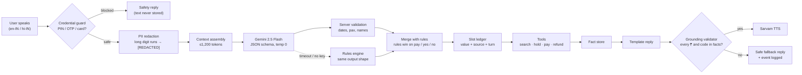

# Context Engineering Harness

> Prompt engineering is about *how you ask*. Context engineering is about **what the model sees, what it is allowed to do, and what you check before its output reaches a customer**. When money is involved, that is the whole product.

Code: [`src/services/contextHarness.ts`](../src/services/contextHarness.ts) · Server-side validation: [`backend/routes/agent.py`](../backend/routes/agent.py) · Tests: [`src/__tests__/harness.test.ts`](../src/__tests__/harness.test.ts)

## One turn, end to end



## The layers

| # | Layer | What it does | Why it matters for a travel/payments product |
|---|---|---|---|
| 1 | **Credential guard** | Blocks UPI PIN / OTP / CVV / card numbers. At the payment stage a bare `4821` or `739201` is treated as a likely PIN | The #1 voice-commerce fraud vector is "just tell me the OTP". The secret must never reach logs or a third-party model |
| 2 | **PII redaction** | Masks 10+ digit runs (phones, account numbers) before text leaves the device | Data minimisation under the DPDP Act. The LLM doesn't need them |
| 3 | **Layered context** | `POLICY` (immutable) → `STATE` (slot ledger, stage, active question, missing slots) → `OPTIONS ON SCREEN` (only at compare stage) → `RECENT DIALOGUE` (last 6 turns, 220 chars each) | Small, ordered and predictable. Lets the model resolve "the second one" or a bare "2" correctly |
| 4 | **Token budget** | 1,200-token cap. Oldest dialogue is trimmed first; policy, state and facts are never dropped | Predictable latency and cost per turn. No "context rot" over long sessions |
| 5 | **Structured output** | Gemini `responseSchema` with an intent enum and typed slots; `temperature 0`; thinking disabled | Parseable every time. No prose to misinterpret |
| 6 | **Server re-validation** | Drops past or far-future dates, travellers outside 1–9, injection-looking city names, and `reply` text outside small talk | A schema guarantees shape, not sense |
| 7 | **Deterministic override** | For `payment_issue`, `payment_failed`, `approve` and `decline`, the rules engine's reading wins if it fires | High-stakes intents should not depend on a probabilistic model |
| 8 | **Slot ledger with provenance** | Each slot stores `value`, `source` (`llm` / `rules` / `ui`) and `turn` | Debuggable ("why did it think Pune?") and measurable (LLM share) |
| 9 | **Fact store** | Only tool outputs (options, holds, payments, refunds) are facts | One source of truth for anything with a number |
| 10 | **Grounding validator** | Every `₹amount` and booking code (`6E-1234-ABCD`, `ORD-…`, `RFD-…`) in a reply must exist in the fact store | Turns "never invent a fare" from a prompt wish into an enforced check |
| 11 | **Context trace** | Per turn: approximate tokens, sections included or dropped, trimmed turns, redactions | Shown in the Insights drawer. This is how you debug an agent in production |

## Example: what Gemini actually receives

```text
### POLICY
You are the language-understanding layer of a voice travel booking agent for Indian users ...
Allowed intents: trip_details, ask_cheaper, ask_fastest, ...

### STATE
TODAY=2026-11-12
JOURNEY_STAGE=discover
ACTIVE_QUESTION=passengers
MISSING=passengers
SLOTS:
destination=Jaipur (from llm, turn 1)
dateISO=2026-11-13 (from llm, turn 1)
origin=Delhi (from rules, turn 2)

### RECENT DIALOGUE
USER: I want to go to Jaipur tomorrow
AGENT: Got it, Jaipur, Fri, 13 Nov 2026. Where will you be travelling from to Jaipur?
USER: Delhi
AGENT: Got it, from Delhi. How many people are travelling?
```

User: `teen log` → model output, validated:

```json
{ "intent": "trip_details", "slots": { "passengers": 3 } }
```

## Why "LLM understands, tools decide, templates speak"

An end-to-end generative agent reads better in a demo, but for bookings and refunds it fails the trust test: one hallucinated fare or PNR becomes a support escalation and possibly a regulatory issue. Splitting responsibilities gives:

- **Correctness by construction:** amounts come from the same objects the UI renders.
- **Graceful degradation:** if Gemini is slow or down, the rules engine produces the same `Understanding` shape and the journey continues.
- **Evaluability:** NLU can be scored on a golden set (`npm run eval`), independently of tools and copy.
- **Localisation:** reply templates can be translated and reviewed by humans per language; the model never writes customer-facing copy about money.

The trade-off is less "chatty" replies. For a payments-adjacent flow, that's the right trade.
