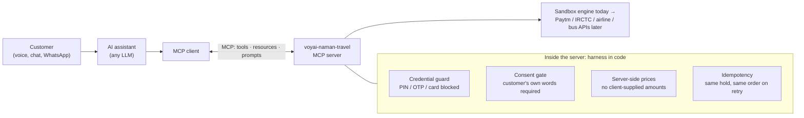

# MCP booking server

The booking tools are exposed as a **Model Context Protocol (MCP) server**, so any agent (Claude Desktop, a WhatsApp bot, the voice web app, another LLM) can search and book Indian flights, trains and buses with **the same tools and the same guardrails**.

Code: [`mcp_server/`](../mcp_server) · Tests: [`mcp_server/tests/`](../mcp_server/tests) · SDK: official Python `mcp` 2.x (`MCPServer`)

> Sandbox: inventory, fares, PNRs and payments are simulated. The guardrails and decision logic are real.

## Why MCP

Without MCP, every channel (web, voice, WhatsApp, partner assistants) integrates its own way with search, booking and payments, and copies the safety rules. With MCP, the tools and rules are written **once**, and every agent discovers and calls them through one standard protocol.

**MCP is how the model reaches the tools. The harness decides what the model is allowed to do with them.** Here the harness lives inside the server, so even a badly prompted client can't book without consent or handle a PIN.

## Architecture



## The booking flow, step by step

> "Find me a morning flight from Bangalore to Delhi tomorrow under ₹6,000."

| # | Step | Tool | Guardrail |
|---|---|---|---|
| 1 | Assistant extracts origin, destination, date, time, budget | none | Resolve the date to YYYY-MM-DD |
| 2 | Search | `search_trips` | Any Indian place; notes if a town has no airport |
| 3 | Compare and present | none | Quote only tool-returned fares |
| 4 | Customer picks; assistant reads back time, fare, refund rule | `get_fare_rules` | Rules come from data |
| 5 | Customer says "haan, book kar do" | `hold_fare` | Rejected without `customer_confirmed` **and** the customer's own words |
| 6 | Payment request | `request_upi_payment` | Approved on the UPI screen; PIN never touches the agent |
| 7 | Bank result (webhook in production) | `sandbox_payment_event` | Sandbox-only tool |
| 8 | Confirmation and PNR | `get_booking_status` | |
| 9 | "Paise kat gaye, ticket nahi aaya" | `reconcile_payment` | Bank ↔ ledger ↔ inventory: ticket or full refund |
| 10 | "Cancel karna hai" | `quote_refund` → `cancel_booking` | Refund quoted first; cancel needs consent |

## What the server exposes

**Tools (9)**

| Tool | Type | What it does |
|---|---|---|
| `search_trips` | read-only | Flights, trains, buses between any two places in India; budget and time-of-day filters; cheapest and fastest ids |
| `get_fare_rules` | read-only | Baggage, refund rule, cancellation fees |
| `hold_fare` | write, idempotent | 10-minute fare lock; consent required |
| `request_upi_payment` | write, idempotent | UPI intent on the same order id (no double charge) |
| `sandbox_payment_event` | write | Simulates bank outcomes: success, declined, timeout, insufficient funds, debited-pending, debited-seat-sold-out |
| `get_booking_status` | read-only | Status, PNR, refund, audit trail |
| `reconcile_payment` | write | 3-way check: ticket issued or full auto-refund |
| `quote_refund` | read-only | Exact refund before cancelling |
| `cancel_booking` | destructive | Cancels and starts the refund; consent required |

**Resources:** `paytm-travel://policies/guardrails` (the rules) and `paytm-travel://places/known` (hubs with real airport and station names).
**Prompt:** `book_trip(request)` starts a safe booking conversation from one Hinglish sentence.

## All of India, not a fixed list

- About 60 hubs have real airport and station names plus approximate coordinates, so distances, durations and fares are realistic (Bangalore → Delhi flight about 2h55m; Mumbai → Nagpur train about 15h).
- **Any other town or village works.** It gets a generated sandbox station with train and bus options.
- Towns without an airport get **no invented flights**, just a note: *"No airport in Haridwar. Nearest airport: Dehradun."*
- Colloquial names are normalised: Bombay → Mumbai, Jodpur → Jodhpur, Bangalore → Bengaluru.

## Run it

```bash
python -m venv .venv-mcp
.venv-mcp\Scripts\activate            # macOS/Linux: source .venv-mcp/bin/activate
pip install -r mcp_server/requirements.txt
python -m mcp_server.server            # stdio
```

**Claude Desktop:** add this to `claude_desktop_config.json`, then restart:

```json
{
  "mcpServers": {
    "voyai-naman-travel": {
      "command": "C:/path/to/.venv-mcp/Scripts/python.exe",
      "args": ["-m", "mcp_server.server"],
      "cwd": "C:/path/to/namanai"
    }
  }
}
```

Then ask: *"Bangalore se Delhi kal subah flight, ₹6,000 ke andar."*

> Windows note: if `pip install` or the import fails with "filename or extension is too long", create the venv at a short path such as `C:\venvs\namanai-mcp`.

## Tests

```bash
pip install pytest
python -m pytest mcp_server/tests
```

16 tests:
- search across any Indian place, colloquial names, no-airport towns, budget and time filters, deterministic ids
- guardrails: PIN blocked in any argument, consent with the customer's own words, no invented option ids, idempotent holds
- payments: success, retry on the same order, debited-pending → ticket, debited-sold-out → full refund
- cancellation: refund maths and consent
- a **real MCP client** listing and calling tools, resources and prompts

## Path to production

1. Replace `TravelEngine` internals with Paytm Travel search, booking and payment services. The tool contracts stay the same.
2. Replace `sandbox_payment_event` with the PSP webhook; the agent only reads status.
3. Add authentication (OAuth via MCP) so tools act for a logged-in user, with per-user order access.
4. Point the voice web app and a WhatsApp agent at this server, so every channel shares one set of tools and guardrails.
